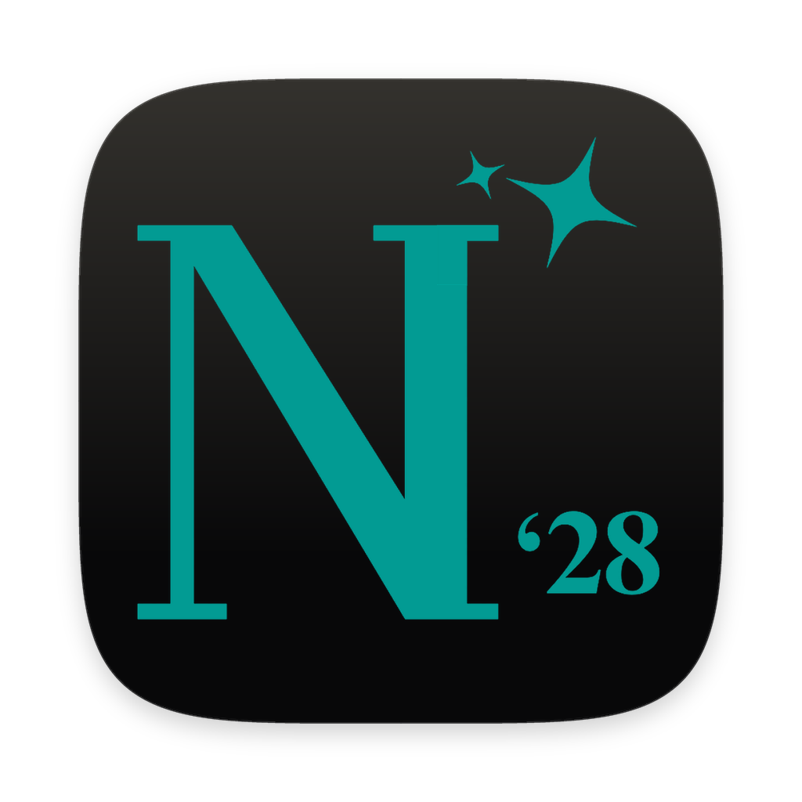

# Nexus '28

Menu-bar AI command center for the Nexus '28 agents, by Apoji_Delegraphics. **v1.3**

<p align="center"></p>

## Install (no paid signing)

Download the DMG for your Mac (Apple silicon = `arm64`, Intel = `x64`) from
[Releases](https://github.com/apojidelegraphics/Nexus-28/releases/latest), drag **Nexus '28** to Applications, then run once:

```bash
xattr -cr "/Applications/Nexus '28.app"
codesign --force --deep --sign - "/Applications/Nexus '28.app"
```

From source, one command builds, installs, signs ad-hoc and opens it:

```bash
npm install
npm run install-app
```

## Run it

```bash
xcode-select --install   # once — builds the on-device helper (speech, Apple Intelligence, Calendar, Reminders)
npm install              # installs deps + builds bin/nexuscore on macOS
npm start                # menu bar + chat
npm test                 # provider, access, voice, agent, cloud tests (no keys needed)
npm run smoke            # boots the real app against mocks (Linux: xvfb-run)
npm run build:helper     # rebuild the Swift helper by itself
npm run dist             # dist/Nexus-28-<version>-<arch>.dmg / .zip (ad-hoc, unsigned)
```

## Three ways in

| | Default key | What |
|---|---|---|
| **Chat** | Click the hexagon in the menu bar, or ⌘⇧N | Full window: chat history on the left, agent picker top right, settings. |
| **Quick Chat** | ⌥⇧Space | Small typing bar. Drag it anywhere; it remembers the spot. ⌘O opens the full chat. |
| **Quick Ask** | ⌥Space | Siri-style voice orb. Talk, pause, it answers out loud. Press again to interrupt. |
| **Explain this** | ⌥⇧E | Highlight text anywhere, press it, pick Explain / Rewrite / Translate… |

Say **"Hey Nexus"** to open Quick Ask hands-free (Settings → Voice; off by default, runs on-device).
All three share the same conversation. Every hotkey can be changed in Settings → General.

### Voice commands
Say **"goodbye"**, **"bye"**, **"sleep"** or **"thank you"** on its own to end a voice session.
Inside a longer sentence ("thank you, what's the weather?") they're treated as a normal request.
"Hey Flash…" / "Neodela, …" switches agents. When Paragon needs approval, answer "yes" or "no".

### Chat keys
Enter send · ⌘K command palette · ⌘N new chat · ⌘R regenerate · ⌘1–⌘4 agent · ⌘B OmniBrief · ⌘D dictate · ⌘, settings · Esc stop/close

## Agents

| Agent | Color | Access |
|---|---|---|
| Paragon | cyan | **Agent**: web search, page reading, Apple Calendar/Reminders, MCP connectors |
| Neodela | violet | Chat only (optionally read-only web search) |
| Lyte | green | Chat only |
| Flash | gold | Chat only |

**OmniBrief** (chip above the input, ⌘B) makes every agent lead with a 1–3 sentence answer.

## What you see while it works
- A live status line: *Connecting to Claude* → *Searching the web · query* → *Reading page · site* → writing.
- Activity chips on each reply (what tools ran, results, declines, errors).
- **Approval cards** before anything that creates, sends, changes or deletes (Approve / Deny).
- Images (inline and from search), source chips, and link previews under replies.
- 🔊 **Read aloud** and copy buttons on every reply (chat and Quick Chat).
- Settings → **Activity** keeps a log of every tool Paragon used.

## Connectors (Settings → Connectors)
- **Web search**: DuckDuckGo (no key), Tavily (best, includes images), or Brave. Pages are read in the app;
  local-network addresses are blocked.
- **Apple Calendar & Reminders**: through the NexusCore helper. macOS asks for access on first use.
- **MCP connectors**: presets for Google Workspace (Gmail/Calendar/Drive/Docs/Sheets), Gmail, Notion, GitHub, Files,
  or any custom MCP server (local command or remote URL). Tokens/env vars are stored encrypted in the Keychain.
  Actions that change things ask first (toggle per connector).

## Voice, read-along and ⌘K
- **Conversation mode**: after "Hey Nexus", keep talking back and forth without saying it again. Say "bye" (or go quiet)
  to end. Talk over Nexus to interrupt it (on-device speech; best with headphones). Turn on "always hands-free" to get
  the same with the Quick Ask hotkey. Settings → Voice.
- **Read-along**: words light up as a reply is read aloud (read-aloud button, spoken replies, Quick Ask).
- **Agent voices**: give Paragon, Neodela, Lyte and Flash their own voice (Settings → Voice → Agent voices).
- **⌘K command palette**: every action, agent, setting, theme, space, routine and chat in one search box.
- **First-run tour**: name, free key or your own key, hotkeys and "Hey Nexus", theme and starting agent. Replay it from
  Settings → General.

## Routines, Morning Brief and Missions
- **Routines** run a prompt on a schedule with any agent (daily, weekdays, certain days, hourly, once). Type or say
  "every weekday at 8, tell me what's due" anywhere, or use Settings → Routines. Each run posts in the **Routines**
  space with a notification. Missed runs (Mac asleep) run once when you're back. Paragon still asks before acting.
- **Morning Brief**: Nexus gathers weather, Calendar, Reminders, unread Gmail (Google connector), headlines and Nexus news
  itself, then an agent (Flash by default, works on the free key) writes a short brief. It arrives at your time, or the
  first time you unlock your Mac after it. "Hey Nexus, good morning" gets it anytime.
- **Missions**: ⋯ → Start a mission. Paragon works on a goal in the background for up to the time you pick, with a
  progress card (Pause / End / Watch), then writes a report into the **Missions** space. Needs your own key.
- Turn on **Open Nexus when I log in** (Settings → General) so routines never miss.

## Spaces, linked chats and stats
- **Spaces** group chats (sidebar chips). Drag chats onto a space; right-click a space to rename, recolor, pick the agent
  new chats start with, or delete it (chats stay). Quick Chat's picker groups chats by space.
- **Link a chat**: type `#` in the chat box and pick a chat. A short summary of it goes with your message. Click the
  pin to keep it linked to every message in this chat (⇧-click: the whole space).
- **Past chats**: agents can look through your earlier chats when you say things like "like we talked about last
  week". Replies show which chats they used. Turn it off in Settings → General.
- **Your name**: Settings → Account → "What should Nexus call you?" Greetings and agents use it.
- **Stats** (Settings → Stats): points, streaks, favorite agent and 22 achievements, with a chime when you unlock one.

## Screen awareness
Nexus only looks when you ask:
- **LOOK** chip (chat window or Quick Chat) attaches the window you were using, with a preview before you send.
- **⌥⇧S** anywhere opens Quick Chat with your screen attached.
- **Voice:** "Hey Nexus, what's on my screen?", "explain this", "what does this error mean?". Follow-ups reuse the
  same picture; "look again" takes a new one; "ask Flash what's on my screen" picks the agent.
- **Paragon** can ask to look (it always asks first).

It captures the front window (never Nexus itself), its app name and title, and reads the text on this Mac, so every
model can follow along; image-capable models also get the picture. Nothing is kept except what you send.
macOS asks for **Screen Recording** permission the first time. Because the app is ad-hoc signed, macOS may ask again
after an update.

## Your Mac (v1.4)
- **Explain this:** highlight text in any app and press **⌥⇧E**. Quick Chat opens with it and one-tap Explain,
  Simplify, Summarize, Rewrite, Fix grammar, Translate and Define. By voice: "Hey Nexus, explain this" uses what you
  highlighted, or your screen if nothing is. Needs **Accessibility** permission once (Settings → Mac has a button).
  Apps that don't share their selection get a quick ⌘C, and your clipboard is put back right after.
- **Clipboard history:** the last 50 things you copied (text only), in memory only, never saved or synced. Password
  manager items are skipped. 📋 in Quick Chat, ⌘K → "Paste from clipboard history", or ask "what did I copy earlier?"
- **App actions (Paragon):** open apps, links and files, run your Apple Shortcuts, set the volume, toggle dark mode,
  play/pause/skip in Spotify or Music, start timers, copy text. Every action shows an approval card first.
- **File finder:** Spotlight search of your home folder by name and contents. ⌘K → type a file name to open it, or ask
  any agent to "find my chem lab report". Reading a file's contents asks first.
- **Watch mode:** ⋯ → Watch a window (or "Hey Nexus, watch this window and tell me when the upload finishes"). Nexus
  reads the window's text on your Mac every 5 s–1 min and only asks AI when the text changed, at most every 30 s.
  Put words in "quotes" ("tell me when it says "Build succeeded"") and it never needs AI. You get a notification and
  it stops when it spots it, the window closes, or time runs out. Up to 3 at once.

## Agents together & @features that do things (v1.5)
- **Every @feature does something now**, not just a prompt tweak. Type `@` to pick one (each agent has its own set):

| Feature | What it does |
|---|---|
| @Seek · @Integrate | Search the web and read pages (Integrate also searches your past chats) |
| @Knowledge | Encyclopedia + dictionary lookup with a reference card |
| @Echo | Reads your recent chats and can search older ones |
| @Cognition | Reasons step by step first; open "Reasoning" to see it |
| @QuantumThread | 3 lines of thought run in parallel, then merged |
| @MultiVerse · @MultiVerseImmersive | 3 scenarios played out in parallel and compared |
| @CommandCore (Paragon) | Plans first, runs the plan with tools, shows the plan + action log |
| @CommandGrid (Paragon) | Live status grid of your tools, connectors, watches, missions, routines |
| @AuraSync | Reads your tone on your Mac and tunes the reply |
| @ClarityLens | Measures reading level; simplifies the answer if it's too hard |
| @SwiftStream | Trims context for speed and shows how fast it answered |
| @OmniBrief | One-to-three sentence answer with an Expand button |
| @VoxLink | Reads the answer aloud |
| @Monolog | Long deep dive with a table of contents and Word/PDF/Markdown export |
| @CodeComplex | Code blocks get Copy, Save and ▶ Run (JavaScript, sandboxed, no network, 3 s limit) |
| @StudyMode | Interactive quiz with a score |
| @Magyk | Flip flashcards |
| @NexusForge | Interactive checklist you can tick off |
| @Synergy | Idea board: star ideas, expand them, combine your favorites |
| @FortressLens | Bar/line/pie charts and a risk matrix |
| @LogicLattice | Proof tree with assumptions and weak links flagged |
| @InsightPulse | Insight cards ranked by strength |
| @Envision | Concept sketches + a color palette |
| @Proactix · @Proactix2.0 | Follow-up chips you can tap (2.0 adds a one-tap Apple Reminder) |

- **Your own @features:** Settings → Features. Name it, tell the agent what to do, pick which agents get it, and
  optionally let it search the web or your chats and show as a checklist, quiz, flashcards, chart, idea board…
- **Huddle:** `@huddle your question` (or @mention two or more agents). They answer side by side, then one sums up.
- **Debate:** `@debate your topic` or ⋯ → Start a debate. Two agents argue FOR and AGAINST, round by round; a third judges.
- **Agent handoff:** Flash and Lyte can hand a message to Neodela or Paragon when it's too much for them
  ("↪ Flash handed this to Neodela"). Settings → Features.
- **Themes:** 6 new themes (Nebula, Rose Quartz, Glacier, Graphite, Synthwave, Deep Forest) and a theme editor
  (Settings → General) with live preview.

## Routines, missions & study (v1.6)
- **Study:** flashcard decks with spaced repetition (SM-2, like Anki): Again / Hard / Good / Easy, keys 1–4, Space to
  flip. Make a deck about any topic (an agent writes the cards), tap **Save to deck** on @Magyk flashcards, or save the
  questions you missed on a @StudyMode quiz. Practice quizzes are built from your own cards. The 📚 chip shows what's due,
  and the Morning Brief and Evening Wrap-up mention it.
- **Evening Wrap-up:** Settings → Routines. At night Nexus looks back at your day (chats, unfinished checklists,
  open reminders, tomorrow's calendar, flashcards) and writes what you got done, what's left and what to start with.
  Or say "Hey Nexus, wrap up my day".
- **Routine triggers:** a routine can run when you join Wi-Fi (any, or a named network), connect headphones, open an
  app, or unlock/wake your Mac, at most once per cooldown. (Newer macOS hides Wi-Fi names unless Location Services is
  allowed for Nexus; "any Wi-Fi" always works.)
- **Mission templates:** Research & compare, Trip planner, Study guide, Topic deep dive, Project kickoff, Learn a skill,
  Gift finder, Inbox catch-up — fill in the blanks. Save your own with {blanks}.
- **Mission sharing:** finished missions export as a formatted **PDF** or **Word** report (cover, report, sources,
  how Paragon got there) or Markdown — from the mission card or the ⋯ menu of a mission chat.

## School, fun & beta (v1.7)
- **Homework helper:** the HOMEWORK chip in Quick Chat, ⌘K, `@Homework`, or "Hey Nexus, help me with this problem".
  It looks at your screen and gives hints one at a time, then the answer, then how to check it yourself.
- **Citation helper:** ⌘K → Cite a source (or `@Cite`). Paste a link or grab the page open in your browser; get MLA 9,
  APA 7 and Chicago, fix any missing author/date, and save to works-cited lists you can copy in one go.
- **Daily challenge:** one small challenge a day (+25 points), shown on the new-chat screen and in Stats.
- **Orb skins:** Aurora, Reactor, Nebula, Pulse, Prism, Pixel and Eclipse, unlocked with points (Settings → Stats).
- **Nexus Wrapped:** your year in Nexus as a slideshow (Settings → Stats or ⌘K). Save it as an image.
- **Beta channel:** admins get new features first, then beta testers, then everyone. Stages live in Supabase
  `feature_flags` (off → admin → beta → all), so features can be opened up without an app update. Settings → **Beta**:
  sign up to test (GitHub issue or email), switch early features off for yourself, report bugs per feature, and get
  prerelease updates (tags like `v1.8.0-beta.1` are published as GitHub prereleases). Admins can preview the app as a
  beta tester or a regular user.
- **Feedback to GitHub or email:** Settings → General → Send feedback.
- **Phone companion (beta):** `docs/companion/` is a phone web app. Turn on GitHub Pages (repo Settings → Pages →
  Deploy from branch → `main` / `docs`), sign in on your phone with your Nexus account, and turn it on in Settings →
  Beta. Your Mac answers while Nexus is open. Needs `supabase/nexus-v1.7.sql` run once.
  v1.7.1 turns it into a full phone app: **Chat** with every agent (classic models too), @feature chips, dictation,
  read aloud, copy, New / Clear chat · **Chats** — all your past chats, searchable, open one and keep talking in it ·
  **Study** — your decks and cards, review due cards (Again/Hard/Good/Easy go back to your Mac) and practice quizzes ·
  **You** — points, streak, today's challenge, achievements, run routines (Morning Brief, Wrap-up) from your phone.
  Needs `supabase/nexus-v1.7.1.sql` run once (adds `companion_sync`).

## v1.9: N28C for everyone, Spaces on the Mac
- **N28C is out of beta.** Settings → **Phone**: connect it, scan the QR code, set notifications, send things to your phone.
- **Send to phone:** 📱 on any answer, ⌘K → "Send clipboard to phone", or Settings → Phone. It lands in N28C → Mac →
  From your Mac, with a notification.
- **Shared Spaces on the Mac:** Study → 👥 Shared Spaces (or ⌘K). Same spaces as on your phone: chat, share and take
  decks, streaks, ask an agent for the group. You get a Mac notification when friends post.
- **Admins:** Settings → Stats → "Unlock every skin". Turn it off to earn skins with points like everyone else.
- **New app icon** for macOS 26: `assets/Nexus.icon` (Icon Composer layers, so it tints with Light / Dark / Tinted /
  Clear like the built-in apps). The release workflow compiles it on a macOS 26 runner (Xcode 26); `assets/icon.png`
  is the flat fallback on Apple's grid. Rebuild both from art with `python3 scripts/make_icon_layers.py <icon.png>`.

## N28C, the phone app (v1.8)
N28C is the phone companion grown up (same address, `docs/companion/`). Add it to your Home Screen for the app icon
and notifications. Needs `supabase/nexus-v1.8.sql` run once.
- **Notifications:** answers, missions, routines, Shared Space posts, a study reminder and an evening streak-saver at
  times you pick. Your Mac sends them itself with Web Push (keys stay in its encrypted key store); no server.
  iPhone: Add to Home Screen first (iOS 16.4+).
- **Send to Mac:** text, a link or a photo → summarize, save to a chat, open the link on the Mac, or copy it there.
  On Android, N28C shows up in the share sheet.
- **Clipboard bridge:** get your Mac's clipboard (and recent copies) on your phone, or send yours to the Mac.
- **Missions from your phone:** start one (templates included), watch it live, end it.
- **Talk mode:** speak, hear the answer, it listens again. Say "bye" to stop.
- **Homework photos:** snap the problem, the Homework helper gives hints first.
- **Interactive answers:** quizzes, flashcards, checklists, charts and the rest work on the phone (same widgets as the
  Mac, copied by `npm run sync:companion`; a test fails if they drift).
- **Chats:** pin, rename, move to a Space, filter by Space. Pins show on the Mac too.
- **Study:** make a deck ("10 cards about the French Revolution"), add and edit cards, cram mode (every card, no
  schedule change), practice quiz.
- **Shared Spaces:** create one, share the 6-letter code, and study with friends: messages, shared decks ("Add to my
  decks"), everyone's streak, and answers from your Nexus posted for the group.
- The theme and orb skin follow your Mac. New skin: **Overlord** (2000 points). The Quick Ask orb now wears your skin.

## Chats, files and quick answers
- **Quick Ask** starts a new chat every time it opens. Press **Enter** (or click the orb) to open that chat.
- **Quick Chat** has a chat picker: type to a new chat or any earlier one, without changing the chat window.
- **Regenerate** (↻ or ⌘R) keeps every answer (‹ 1/3 ›). Hold ↻ (or click ▾) to regenerate with another agent.
- **Attach** images, PDFs and text files: 📎, drag and drop, paste, or drop a file on the menu-bar icon.
- **Export** a chat (⋯ menu): Markdown, PDF, Word, plain text, JSON.
- **calc** and **convert** answer instantly without using a chat: `calc 15% of 80`, `convert 5 mi to km`.
- **Send feedback** from Settings → General.

## Free Nexus key & chat limits
No API key? Nexus uses the shared Nexus OpenRouter key (fetched from the Nexus cloud at runtime, never stored on disk)
with the same limits as the web Nexus:

| Tier | Models | Free-key chats |
|---|---|---|
| **Ultra** | Paragon | Not on the free key. Use your own key, or a local model (chat only, no agent tools) |
| **Best** | Neodela + classic models | 28 per model |
| **Standard** | Lyte, Lyte -27, Lyte -2.6 | 95 per model |
| **Base** | Flash | Unlimited |

Your own API keys, local models (Ollama, LM Studio, Apple Foundation Models) and comped accounts have no limits.
Signed in, counts sync with the web; as a guest they're kept on this Mac. Toggle it in Settings → Providers.

## Redeem aARgon3 / Mexel orders
Settings → Account → **Redeem**: enter your order number (e.g. `MRH33QFL-RA6C`). Nexus checks the order in the
aARgon3 & Mexel store, records the redemption on your Nexus account, and every model in that order becomes
unlimited on the free key. Each order can be redeemed on one account. Requires sign-in.

## Updates
Nexus checks GitHub Releases at launch and every 6 hours (Settings → General → Updates, or the menu-bar menu).
When a newer version exists you get a notification and a banner with **Download**. It never installs anything by itself.

## Nexus account & cloud sync
- Agent prompts (Paragon, Neodela, Lyte, Flash) sync from your Supabase `assistant_prompts` table
  (rows named "Nexus 28 …"), cached for offline use, re-checked every 10 minutes or via Settings → Account → Sync now.
- Optional sign-in with your web Nexus account: shows your username and BETA/COMPED status. The session token is
  stored encrypted in the Keychain.
- Active announcements and maintenance notices from the web Nexus appear as banners in the chat.

## Classic models & @features
- The agent menu (top right) has **Classic models**: every older Nexus model in Supabase (Dahrk, Armerad, Denali,
  Sonoma, Myst, Hailos…). They're chat-only and share one backend (Settings → Agents → Classic models). Mention them
  with @armerad, @hailos92o, etc.
- **@Features** from the classic Nexus — @Seek, @Cognition, @Integrate, @Knowledge, @Envision, @Synergy, @Echo,
  @QuantumThread, @AuraSync, @NexusForge, @Magyk, @LogicLattice, @InsightPulse, @ClarityLens, @FortressLens,
  @Proactix, @MultiVerseImmersive, @Monolog, @StudyMode, @CodeComplex, @OmniBrief, @SwiftStream, and Paragon's
  @CommandCore / @CommandGrid / @VoxLink. Each agent only gets the features listed for it in Supabase.
  @Seek searches the web for that message; @Echo pulls in your recent chats. Features taken offline with
  feature-level maintenance on the web are skipped.

## Account
Settings → Account: sign in, create an account, reset password, change username / email / password, see web usage,
redeemed orders and account status.

## More connectors
- **Weather** (Open-Meteo, free, no key): set a default location in Settings → Connectors. Replies include a weather card.
- **Supabase** (MCP preset): official server, read-only by default, pointed at your Nexus project. Needs a personal
  access token from supabase.com/dashboard/account/tokens.

## Read aloud
The 🔊 button uses your Mac's System Voice. Set it to a Siri voice in System Settings → Accessibility → Spoken Content
(Settings → Voice has a button that opens it). Replies also render markdown tables.

## Providers
Claude, ChatGPT, Gemini, DeepSeek, OpenRouter · Ollama, LM Studio (local) · Apple Foundation Models (on-device, no tools).
If a local model can't call tools, Nexus answers without them and says so.

## Layout
```
main.js               windows, hotkeys, IPC (chat/agent, conversations, connectors, voice)
src/providers.js      streaming + tool calling for every backend
src/agent.js          agent loop (tools, approvals, activity)
src/tools.js          built-in tools + routing to MCP
src/web.js            search, page reading, link previews, private-network guard
src/mcp.js            MCP client manager + presets
src/conversations.js  chat history
src/personas.js       Nexus '28 prompts, Paragon-only gating, OmniBrief
src/access.js         tiers, free-key limits, order entitlements
src/cloud.js          Nexus + aARgon3/Mexel Supabase (prompts, account, usage, redemptions)
src/updater.js        GitHub release checker
src/attachments.js    files, images, screenshots → model content
src/screen.js         screen awareness (front window capture)
src/quickcalc.js      calc / convert
src/exporter.js       Markdown / text / JSON / Word / PDF export
src/routines.js       scheduled routines + Morning Brief runner
src/schedule.js       schedules and "every weekday at 8, …" parsing
src/brief.js          Morning Brief gathering + prompt
src/missions.js       background Paragon missions
src/chatsearch.js     past-chat search, transcripts, linked-chat digests
src/metrics.js        stats, points, achievements
src/macactions.js     app actions (open, Shortcuts, volume, music, timers) + Spotlight file finder
src/cliphistory.js    clipboard history (memory only, skips concealed items)
src/watch.js          Watch mode (local text diff, AI only on change)
src/featurekit.js     what each @feature does (tools, pre-passes, local analysis, widgets, handoff)
src/groupchat.js      Huddle + Debate
src/knowledge.js      encyclopedia + dictionary lookups
renderer/widgets.js   quiz, flashcards, checklist, idea board, charts, risk matrix, logic tree… + code Run/Save
renderer/theme.js     built-in + custom themes
src/study.js          flashcard decks + spaced repetition
src/triggers.js       routine triggers (Wi-Fi, headphones, app launch, unlock)
src/missiontemplates.js / src/missionreport.js   mission templates and shareable reports
renderer/study.js     the Study panel
src/flags.js          beta channel (feature stages, preview, opt-out)
src/citations.js      citation reading + MLA / APA / Chicago
src/challenges.js · src/wrapped.js   daily challenge, Nexus Wrapped
src/relay.js          phone companion relay (desktop side); docs/companion/ is the phone side
supabase/nexus-v1.7.sql   feature_flags + relay_messages tables (run once)
supabase/nexus-v1.7.1.sql companion_sync table for the phone app (run once)
supabase/nexus-v1.8.sql   phone photos + Shared Spaces (run once)
src/voice.js          helper process, macOS say, ElevenLabs/OpenAI speech
src/store.js          settings, Keychain keys/secrets, action log
native/               NexusCore.swift (speech, "Hey Nexus", screen text (Vision), PDF text, Foundation Models, EventKit, selected text)
renderer/             index.html/hud.js/settings.js (chat), quickchat.*, quick.* (voice orb), chatview.* (shared)
test/                 unit tests, fake helper, fake say, test MCP server, Electron smoke test (npm run smoke)
```

## License
© 2026 Apoji_Delegraphics. All rights reserved.

## Releasing
Push a tag and GitHub Actions builds the Mac app and publishes the release (`.github/workflows/release.yml`):
```bash
git tag v1.0.1 && git push origin v1.0.1
```
Bump `"version"` in package.json first so the update checker sees a newer version.
