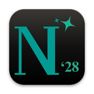

<p align="center"></p>

<h1 align="center">Nexus '28</h1>
<p align="center"><b>Your AI crew, one keystroke away.</b><br>A menu-bar AI for your Mac, with N28C on your phone.</p>
<p align="center">
  <a href="https://github.com/apojidelegraphics/Nexus-28/releases/latest"><b>Download for Mac</b></a> ·
  <a href="https://apojidelegraphics.github.io/Nexus-28/">Website</a> ·
  <a href="https://apojidelegraphics.github.io/Nexus-28/companion/">N28C on your phone</a> ·
  <a href="https://github.com/apojidelegraphics/Nexus-28/issues">Report a bug</a>
</p>

---

## What is it?

Nexus '28 lives in your menu bar. Press **⌘⇧N** (or say **"Hey Nexus"**) and a crew of AI agents is ready:

| Agent | Good for |
|---|---|
| **@flash** | fast answers, quick facts, short replies |
| **@lyte** | clear explanations, studying, writing help |
| **@neodela** | deep thinking, careful reasoning, long answers |
| **@paragon** | doing things: web research, your apps, missions |

Mention one, mix several in one message, or just type and let Nexus pick. Classic models are there too.

## Highlights

- **⚑ Missions.** Give Paragon a goal and a time limit. It works in the background and hands you a report (PDF or Word).
- **◍ Huddles and ⚖ debates.** Ask several agents at once and get one summary, or have two argue while a third judges.
- **🎙 Voice.** A floating orb that listens, thinks and talks back with a Siri, ElevenLabs or OpenAI voice.
- **👁 Screen help.** "What's this error?" Nexus looks at the window you're in. It can also watch a window and ping you when something happens.
- **⟳ Routines and Morning Brief.** Your day at a glance every morning, plus routines you write in plain English.
- **📚 Study.** Make a flashcard deck in one line, review it with spaced repetition, take practice quizzes, and study with friends in **Shared Spaces**.
- **📐 Homework helper.** You get hints first, then the answer, then a way to check it.
- **❝ Citations.** MLA, APA or Chicago from any link, organized by project.
- **🏆 Points, streaks, daily challenges and orb skins**, plus a yearly **Nexus Wrapped**.

## N28C: Nexus on your phone

Open **Settings → Phone** in the app, turn it on, and scan the QR code. On iPhone, tap **Share → Add to Home Screen**.

- Chat with every agent, browse your chats and keep any of them going.
- Talk mode, read aloud in your Mac's voice, and homework photos.
- Send links, notes and photos to your Mac, and share the clipboard both ways.
- Start missions, huddles and debates, and get a notification when they're done.
- Review flashcards, and get a study reminder and an evening streak-saver.

Your Mac does the work, so keep Nexus open there.

## Install

1. Download the latest **DMG** from [Releases](https://github.com/apojidelegraphics/Nexus-28/releases/latest). It's for Apple silicon Macs with macOS 13 or later.
2. Open it and drag **Nexus '28** to **Applications**.
3. Nexus isn't in the App Store yet, so run this once in Terminal:
   ```
   xattr -cr "/Applications/Nexus '28.app"
   ```
4. Open Nexus '28. It shows up in your menu bar. A short tour walks you through the rest.

Updates install from inside the app.

## Free to use

Nexus comes with a **free Nexus key**, so you can start chatting right away. Each agent has a number of free chats. For unlimited use you can:

- add your own key for OpenAI, Anthropic (Claude), Gemini, DeepSeek or OpenRouter,
- run a local model (Ollama, LM Studio or Apple's on-device model), or
- redeem an aARgon3 / Mexel order.

Go to **Settings → Models & keys**.

## Privacy

- Your chats, keys, stats and flashcards stay **on your Mac**.
- Signing in to a Nexus account is optional. It syncs only what you turn on, like N28C or Shared Spaces, and only you (or the people in your Shared Space) can see it.
- To answer, your message goes to the AI provider you chose (or stays on your Mac with a local model).

## Be a beta tester

Want new features first? Open **Settings → Account → Sign up to be a beta tester**. Beta testers get early features and beta updates.

## Help and feedback

- **Settings → General → Send feedback** sends a bug report or idea to GitHub or by email.
- Questions and bugs: [GitHub Issues](https://github.com/apojidelegraphics/Nexus-28/issues).

---

<sub>Building Nexus yourself or running your own Supabase backend? See **[docs/DEVELOPERS.md](docs/DEVELOPERS.md)**.<br>Nexus '28 by Apoji Delegraphics.</sub>
