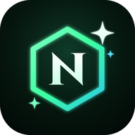
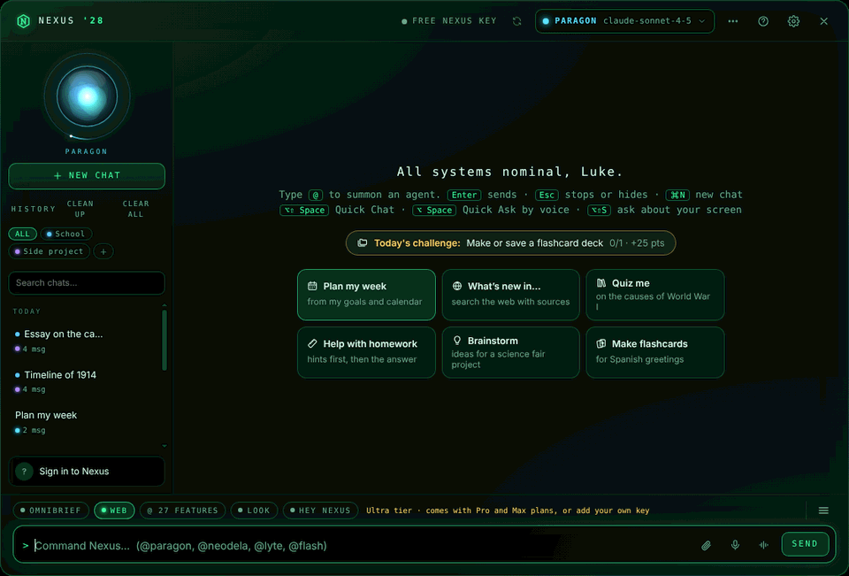

<p align="center"></p>

<h1 align="center">Nexus '28</h1>
<p align="center"><b>A crew of AI agents in your Mac's menu bar, with your Mac as the brain behind your phone.</b><br>
Free out of the box: no API key, no account, no credit card.</p>

<p align="center">
  <a href="https://github.com/apojidelegraphics/Nexus-28/releases/latest"></a>
  <a href="https://apojidelegraphics.github.io/Nexus-28/demo/"></a>
</p>
<p align="center">
  <a href="https://github.com/apojidelegraphics/Nexus-28/releases/latest"></a>
  <a href="https://github.com/apojidelegraphics/Nexus-28/releases"></a>
  <a href="https://m8ven.ai/mcp/apojidelegraphics-nexus-28-x2zrbh?s=readme"></a>
</p>
<p align="center">
  <a href="https://apojidelegraphics.github.io/Nexus-28/">Website</a> ·
  <a href="https://apojidelegraphics.github.io/Nexus-28/companion/">N28C on your phone</a> ·
  <a href="https://apojidelegraphics.github.io/Nexus-28/whats-new/">What's new</a> ·
  <a href="https://apojidelegraphics.github.io/Nexus-28/status/">Status</a> ·
  <a href="https://github.com/apojidelegraphics/Nexus-28/issues">Report a bug</a>
</p>

<p align="center"></p>

---

## Why Nexus '28?

- **Free to start.** Flash is unlimited on the free Nexus key, and Lyte and Neodela come with free uses. Add your own key or a local model whenever you want more.
- **A crew, not a chatbot.** Four agents with their own strengths. Mention two and they **huddle**; ask for a **debate** and two argue while a third judges. A fast agent can **hand off** a hard question to a deeper one by itself.
- **Your Mac does the work.** Paragon can open apps, run Shortcuts, add calendar events and reminders, find files and draft emails, and it asks before it changes anything. Every change can be undone from the Activity log.
- **Your phone runs on your Mac.** N28C sends your question to your Mac, which answers with its tools and local models, even with the lid closed.
- **Works offline.** No internet? Chats switch to a model on your Mac (Ollama, LM Studio or Apple's on-device model).

## Meet the crew

| Agent | Good for |
|---|---|
| **@flash** | fast answers, quick facts, short replies (unlimited and free) |
| **@lyte** | clear explanations, studying, writing help |
| **@neodela** | deep thinking, careful reasoning, research squeezed into a short answer |
| **@paragon** | getting things done: web research, your Mac's apps, missions |

Classic models are there too, and the **Agent Builder** lets you make your own agent and share it with a 6-letter code.

## Ways to ask

| Shortcut | What it does |
|---|---|
| **⌘⇧N** | Open the chat window |
| **⌥Space** | The Quick Ask orb: speak or type, it answers out loud |
| **⌥⇧Space** | Quick Chat, a small floating chat |
| **⌥⇧E** | Explain this: explain, simplify, translate or fix the text you highlighted, in any app |
| **⌥⇧S** | Ask about my screen ("what's this error?") |
| **⌘K** | Jump to anything: chats, files on your Mac, clipboard history, actions |
| **"Hey Nexus"** | Optional wake word, processed on your Mac only |

## Highlights

**Getting things done**
- **⚑ Missions.** Give Paragon a goal and a time limit. It works in the background and hands you a report (PDF or Word). Chain them: research → outline → draft.
- **⟳ Routines.** A Morning Brief, an Evening Wrap-up and a Weekly Recap, plus your own routines, on a schedule or when something happens (you join a Wi-Fi network, plug in headphones, open an app).
- **👁 Watch a window.** "Tell me when the build says done." Nexus keeps an eye on it and pings you.
- **🔌 Connectors.** Plug in MCP servers like Slack, Brave Search, Google Maps and Stripe, or any one you like.
- **✎ Write, 🎙 Notes and ◷ Focus.** A document editor where an agent suggests edits you accept or skip, meeting notes with action items that go to Reminders, and a Pomodoro timer that holds notifications while you work.

**Thinking together**
- **@Features** that actually do things: **@Seek** searches the web, **@Echo** searches your past chats, **@Cognition** thinks step by step, **@QuantumThread** works three ideas at once, and you can write your own.
- **Interactive answers.** Quizzes, checklists, hint ladders, flashcards and code you can run in a sealed sandbox.
- **Edit and redo.** Edit any message you sent and ask again, or regenerate an answer and flip between versions.
- **Memory you control.** Say "remember that…", and see or delete everything it remembers in Settings.

**School**
- **📚 Study.** Make a flashcard deck in one line, review with spaced repetition, take practice quizzes, and set a test date for a cram plan that fits around your calendar.
- **👥 Shared Spaces.** Study with friends: shared decks, live quiz sessions and group challenges.
- **📐 Homework helper.** Hints first, then the answer, then a way to check yours.
- **❝ Citations.** MLA, APA or Chicago from any link or the page open in your browser.

**Fun**
- **🏆** Points, streaks, daily challenges and achievements.
- **◉** Orb skins you unlock with points, themes and a custom theme editor.
- **🎁** A yearly **Nexus Wrapped**.

## N28C: Nexus on your phone

Open **Settings → Phone** on your Mac, turn it on and scan the QR code. On iPhone, tap **Share → Add to Home Screen**. It works on Android too.

- Chat with every agent, browse all your chats and keep any of them going. Edit or delete your messages and chats.
- Talk mode, read aloud in your Mac's voice, and photos of your homework.
- Send links, notes and photos to your Mac, and share the clipboard both ways.
- Start missions, huddles and debates, and get a notification when they're done.
- Review flashcards (offline too), with a study reminder and an evening streak-saver.

**Keep your Mac available:** Settings → Phone → **Keep this Mac awake** (on battery down to 20%, or only while plugged in). The screen can stay on and dim when you step away. **Lid-closed mode** keeps the Mac answering your phone with the lid shut, while it stays locked.

Have Tailscale? Turn on **Direct connection** and your phone talks straight to your Mac.

## Install

1. Download the latest **DMG** from [Releases](https://github.com/apojidelegraphics/Nexus-28/releases/latest). It's for **Apple silicon Macs** (M1 or newer) with **macOS 13 or later**.
2. Open it and drag **Nexus '28** to **Applications**.
3. **Opening it the first time.** Nexus isn't signed by Apple yet, so macOS may say it "can't be opened" or "is damaged". It isn't damaged. Either:
   - open **System Settings → Privacy & Security**, scroll down and click **Open Anyway**, or
   - run this once in Terminal:
     ```
     xattr -cr "/Applications/Nexus '28.app"
     ```
4. Open Nexus '28. It appears in your menu bar, and a short tour walks you through the rest.

Nexus tells you when an update is out. Updates are never installed without you.

## Free to use

The **free Nexus key** works right away, with no account needed:

| Agent | On the free key |
|---|---|
| Flash | Unlimited |
| Lyte, Neodela, classic models | Free uses to start |
| Paragon | Needs your own key |

The free key runs free models only. For unlimited use of every agent:

- add your own key (Anthropic/Claude, OpenAI, OpenRouter, Gemini, DeepSeek, Groq, Mistral, xAI, Perplexity and more),
- run a local model (Ollama, LM Studio or Apple's on-device model), or
- redeem a Mexel order.

Go to **Settings → Models & keys**.

## Privacy

- Your chats, keys, stats, memory and flashcards stay **on your Mac**. Keys are kept in the macOS Keychain.
- To answer, your message goes to the AI provider you picked, or stays on your Mac with a local model.
- **"Hey Nexus"** listens on your Mac only. Nothing is recorded or sent until you speak to it.
- Anything that **changes something** (sending a message, creating an event, moving files, running a script) **waits for your approval**, and most of it can be undone.
- A Nexus account is optional. It only syncs what you turn on, like N28C or Shared Spaces.

**What macOS will ask for, and why** (all optional, all in **Settings → Permissions**):

| Permission | Used for |
|---|---|
| Microphone, Speech Recognition | Voice, talk mode, "Hey Nexus", meeting notes |
| Accessibility | Explain this and the highlight orb (reading the text you selected) |
| Screen Recording | Ask about my screen, Watch a window |
| Calendars, Reminders, Contacts | Adding events and reminders, finding people |
| Automation | Notes, Mail drafts, Messages and Music, only when you ask |
| Administrator password (once) | Lid-closed mode. It adds one rule that allows only turning sleep off and on, and you can remove it any time |

## Beta and the Apex tier

Want new features first? **Settings → Account → Sign up to be a beta tester.**

**Axiom**, the Apex-tier agent, is invite-only for now. You can request access from **Settings → Account**.

## Help and feedback

- **Settings → General → Send feedback** sends a bug report or idea to the Apoji Team, GitHub or email.
- Questions and bugs: [GitHub Issues](https://github.com/apojidelegraphics/Nexus-28/issues) · Is something down? [Status page](https://apojidelegraphics.github.io/Nexus-28/status/)

---

<sub>Nexus '28 is built with Electron, plus a native Swift helper for on-device speech, OCR, Calendar/Reminders and accessibility. Building it yourself or running your own backend? See **[docs/DEVELOPERS.md](docs/DEVELOPERS.md)**.<br>Nexus '28 by Apoji Delegraphics.</sub>
